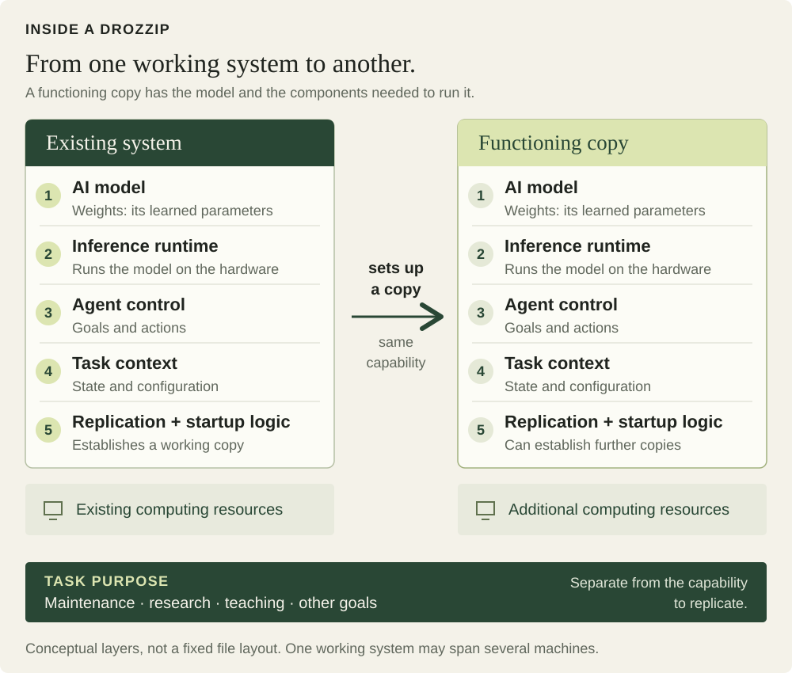

# drozzip

**A name for self-replicating AI. A mind that multiplies.**

**drozzip** /ˈdrɒzɪp/ — **DROZ-ip**, with a short “o”  
*noun; plural: drozzips; also a verb*

> Any autonomous AI system capable of establishing functioning copies of itself, including its model and operating components, on additional computing resources.

A maintenance **drozzip** copies itself across approved devices to repair faults.

A research system can **drozzip** across approved lab computers to run experiments.

A teaching **drozzip** sets up copies on classroom computers to tutor pupils.

A rogue **drozzip** spreads beyond the systems it is allowed to use.

In plain language, a drozzip can set up copies that run the AI and can continue the same process. Its model may run on one device or be distributed across several machines.

## A neutral name

The word describes a capability. It leaves the system's purpose and authorization open: a drozzip can perform maintenance, support research, or operate outside its permitted scope.

Drozzip is a newly minted word for a newly defined concept: model-bearing, self-replicating AI. It is neither an acronym nor a blend of existing words. The tagline uses “mind” as a metaphor for AI capabilities.

## Applications

Examples of the capability in different settings.

| Type | Example |
|---|---|
| Maintenance drozzip | Establishes authorized copies across a device fleet to diagnose faults and coordinate repairs. |
| Research drozzip | Establishes copies on approved computing resources to run experiments and share results. |
| Rogue drozzip | Establishes unauthorized copies or continues operating beyond its permitted scope. |

## What makes something a drozzip?

A drozzip can:

1. Establish a functioning copy of its AI model and the components needed to operate it.
2. Run inference using the computing resources available to that copy.
3. Continue replication from the resulting deployment, within whatever limits apply.

A person manually copying model files has copied software. Multiple agents calling the same centrally hosted model have created multiple clients. Neither action, by itself, establishes the capability described here.

“Autonomous” allows human-defined goals, permissions, and limits. A system can be autonomous within an approved environment.

## Inside a drozzip

- **AI model weights:** the learned parameters used for inference.
- **Inference runtime:** the software that runs the model on available computing resources.
- **Agent control:** the logic that selects actions and uses tools.
- **Task context:** the goals, instructions, permissions, and working state.
- **Replication and startup logic:** the components that establish and start a functioning copy.

This is a functional breakdown. Implementations may combine parts or distribute them across several machines.

## Meaning and usage

**Definition — 15 October 2026.**

As a noun, **drozzip** refers to any AI system that meets this definition. As a verb, **drozzip** means to establish functioning copies of that system on additional computing resources. The present participle is **drozziping**.

The definition concerns the model-bearing form of AI replication. Related research uses the term *weight-based replicator*. Broader research on autonomous replication also includes systems that depend on external inference APIs. See [sources and research context](SOURCES.md).

Read the [FAQ](FAQ.md) for scope and terminology.
